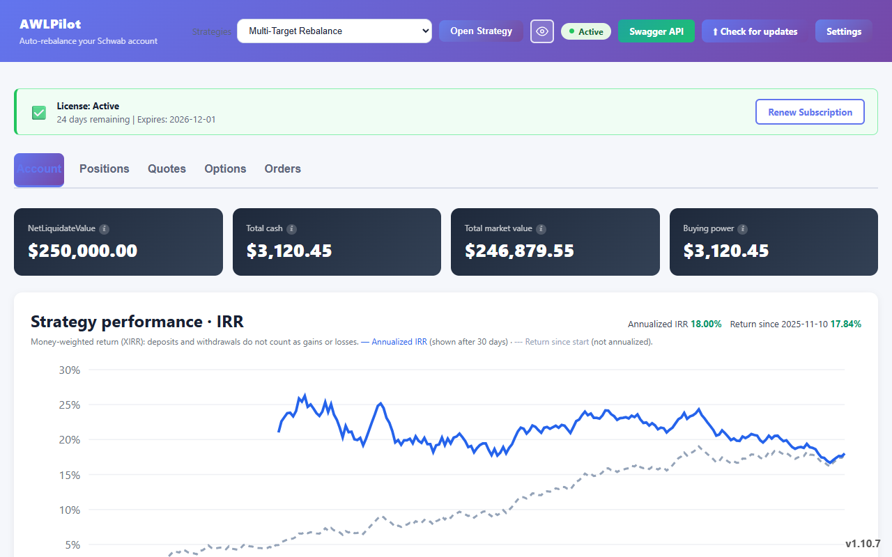
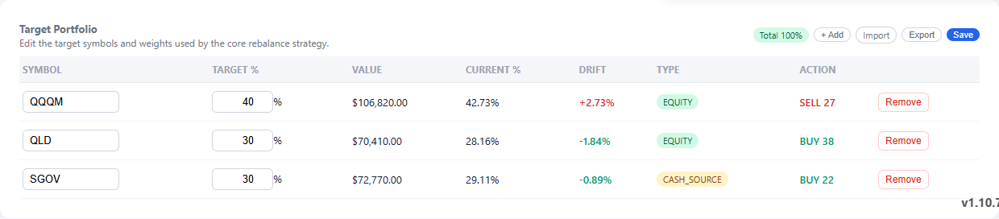
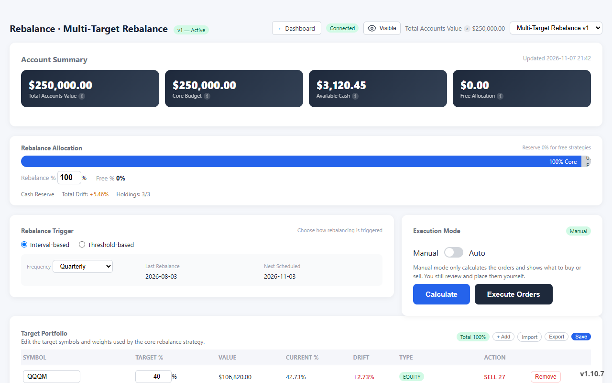
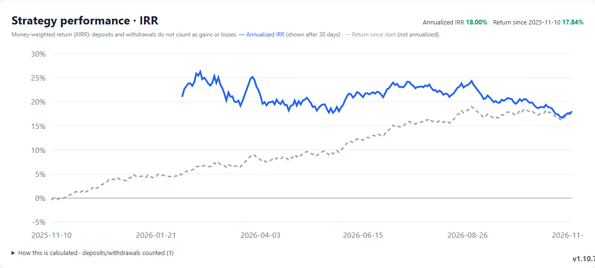
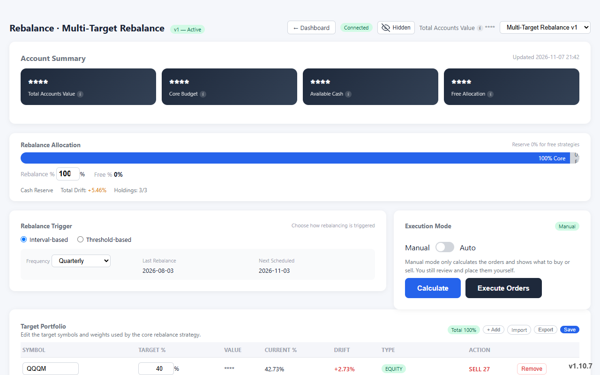

# AWLPilot on one computer: quick start / 单机快速上手

[English](#english) · [中文](#中文)

> Other ways to start / 其他上手方式：
> two computers or a home server / 两台电脑或家用服务器 → [Two-Computer-Setup.md](Two-Computer-Setup.md) ·
> let your AI agent install it / 让 AI agent 帮你装 → [Agent-Setup.md](Agent-Setup.md)
>
> All screenshots use demo data. 所有截图均为演示数据。

---

## English

### What you will have at the end

About 15 minutes of your time (plus the days Schwab takes to approve your developer app, see step 0):

- Your Schwab account on screen, with your **target mix next to your real mix** and the exact buy/sell list that closes the gap.
- Your strategy's **real return (IRR)**: deposits and withdrawals do not count as gains or losses.
- With Pro: the orders placed for you, by one click or automatically. Free never places an order.
- Everything stays on this computer. One click hides every dollar amount on screen.



### 0. Before you start: the Schwab developer app (only you can do this)

You need a Schwab brokerage account and an **approved** Schwab Individual Developer app. Registration needs a US
(+1) phone number and approval usually takes a few business days, so start this first.
Step by step: [Charles Schwab Developer Registration Guide](Charles%20Schwab%20Developer%20Registration%20Guide.md).
Set the app's **Callback URL** to exactly `https://127.0.0.1:8443/`.

You can install AWLPilot and look around while you wait.

### 1. Install

| Your computer | Download from [the latest release](https://github.com/memoryfraction/AWLPilot-Public/releases/latest) | Then |
|---|---|---|
| Windows 10/11 (x64) | `QuantInfraNetPro.Web-win-x64-Setup.exe` | Run it. It installs for your user only (no admin needed) and starts AWLPilot. |
| Linux (x64) | `QuantInfraNetPro.Web-linux-x64.AppImage` | See the commands below. |
| macOS | not available at the moment | Use a Windows or Linux computer, or a Linux server ([Two-Computer-Setup.md](Two-Computer-Setup.md)). |

Linux:

```bash
sudo apt install -y libfuse2          # AppImages need FUSE
mkdir -p ~/Applications
curl -fL -o ~/Applications/Quant.Infra.Net.Pro.AppImage \
  "https://github.com/memoryfraction/AWLPilot-Public/releases/latest/download/QuantInfraNetPro.Web-linux-x64.AppImage"
chmod +x ~/Applications/Quant.Infra.Net.Pro.AppImage
~/Applications/Quant.Infra.Net.Pro.AppImage
```

Keep that exact file name: the built-in updater replaces it in place. No separate .NET install is needed.

### 2. Open it and start the free trial

1. Open **https://127.0.0.1:8443** in your browser. AWLPilot creates its own local certificate and Windows trusts
   it automatically. If the browser still warns, that is the local certificate: continue once.
2. Accept the license agreement.
3. On `/start`, enter your email → **Verify Email** → click the link in your inbox → back on `/start`, click
   **Verify Email** again → click the free-trial button. No card needed. The app shows how long the trial lasts.

### 3. Connect Schwab

1. On `/settings`, type your Schwab **App Key**, **App Secret** and **Account Number** into the app.
   Optionally save your Schwab login so AWLPilot can sign in again by itself every 7 days.
2. Go to `/signin`, log in at Schwab and approve. You come back to the dashboard.

Schwab's login lasts 7 days. With the login saved, AWLPilot renews it on its own; otherwise a banner asks you to
sign in again. If Schwab asks for a phone code (MFA), AWLPilot stops and tells you. It never bypasses MFA.

### 4. Set your target and see the gap

On `/Rebalance`, enter your target weights (for example 60% VTI / 40% BND) and save.



AWLPilot shows the drift of each holding and the exact buy/sell list that brings you back:



- **Free:** place those orders yourself at Schwab.
- **Pro:** click **Execute Orders**, or switch to automatic mode with your own trigger (a drift threshold or a schedule).
  Automatic trading is off until you turn it on, and it asks you to confirm the risk first.

### 5. Every day

- **Dashboard:** account value, positions and your IRR over time.
  
- **Privacy switch:** one click hides every amount, for screen sharing or screenshots.
  
- **Upgrades:** a banner appears when a new version exists; `/update` → **Upgrade & Restart**. Your settings are
  backed up first and never overwritten.
- **Renew:** Dashboard → **Renew Subscription**, or `/renew`. Plans and prices:
  https://www.alpha-wealth-lab.com/pricing/

### Where your data lives

Windows `%APPDATA%\Quant.Infra.Net.Pro\`, Linux `~/.config/Quant.Infra.Net.Pro/`. Uninstalling or upgrading the
program never touches it. Details: [README → Where your data lives](README.md#where-your-data-lives).

### If something does not work

| Symptom | Fix |
|---|---|
| The browser cannot open https://127.0.0.1:8443 | AWLPilot is not running: start it again from the Start menu (Windows) or run the AppImage (Linux). |
| You keep landing on `/start` | The trial or license is not active yet: finish step 2. |
| Schwab login fails or "callback" error | The Callback URL in the Schwab portal must be exactly `https://127.0.0.1:8443/`, and the app must be **Approved**. |
| "Not authorized" banner | Go to `/signin` and log in at Schwab again. |
| Anything else | Ask your AI agent with [Agent-Setup.md](Agent-Setup.md), or open a [GitHub issue](https://github.com/memoryfraction/AWLPilot-Public/issues). |

---

## 中文

### 做完之后你会得到什么

你自己大约花 15 分钟（另加嘉信审核开发者应用的几天，见第 0 步）：

- 在屏幕上看到嘉信账户，**目标比例和实际比例并排**，以及把差距补回来的精确买卖清单。
- 策略的**真实收益（IRR）**：入金、出金不算盈亏。
- 有 Pro 时，由软件替你下单：一键执行或自动执行。免费版从不下单。
- 一切都留在这台电脑上，一键隐藏屏幕上所有金额。


### 0. 开始之前：嘉信开发者应用（只能你本人办）

需要一个嘉信证券账户，和一个**已批准**的嘉信个人开发者应用。注册要 +1 美国手机号，审核一般要几个工作日，所以先办这一步。
详细步骤：[Charles Schwab 开发者注册指南](Charles%20Schwab%20Developer%20Registration%20Guide.md)。
应用的 **Callback URL** 必须填 `https://127.0.0.1:8443/`，一字不差。

等审核期间，可以先装好 AWLPilot 看看。

### 1. 安装

| 你的电脑 | 到[最新版本](https://github.com/memoryfraction/AWLPilot-Public/releases/latest)下载 | 然后 |
|---|---|---|
| Windows 10/11（x64） | `QuantInfraNetPro.Web-win-x64-Setup.exe` | 双击运行。只为当前用户安装（不需要管理员），装完自动启动。 |
| Linux（x64） | `QuantInfraNetPro.Web-linux-x64.AppImage` | 见下面的命令。 |
| macOS | 暂无 | 请用 Windows 或 Linux 电脑，或装在 Linux 服务器上（[两台电脑教程](Two-Computer-Setup.md)）。 |

Linux：

```bash
sudo apt install -y libfuse2          # AppImage 需要 FUSE
mkdir -p ~/Applications
curl -fL -o ~/Applications/Quant.Infra.Net.Pro.AppImage \
  "https://github.com/memoryfraction/AWLPilot-Public/releases/latest/download/QuantInfraNetPro.Web-linux-x64.AppImage"
chmod +x ~/Applications/Quant.Infra.Net.Pro.AppImage
~/Applications/Quant.Infra.Net.Pro.AppImage
```

文件名请保持不变，内置升级会原地替换它。不需要另装 .NET。

### 2. 打开并开始免费试用

1. 浏览器打开 **https://127.0.0.1:8443**。AWLPilot 会生成自己的本地证书，Windows 会自动信任。浏览器如果仍然提示，那是本地证书，继续访问一次即可。
2. 接受许可协议。
3. 在 `/start` 输入邮箱 → **Verify Email** → 点收件箱里的链接 → 回到 `/start` 再点一次 **Verify Email** → 点免费试用按钮。不用绑卡，试用时长以软件显示为准。

### 3. 连接嘉信

1. 在 `/settings` 把嘉信 **App Key**、**App Secret** 和**账号**填进软件。也可以保存嘉信登录信息，让 AWLPilot 每 7 天自动重新登录。
2. 打开 `/signin`，在嘉信页面登录并授权，然后会回到仪表盘。

嘉信登录有效期 7 天。保存了登录信息时 AWLPilot 自动续上，否则页面顶部会提醒你重新登录。嘉信要求手机验证码（MFA）时，AWLPilot 会停下并提醒你，绝不绕过。

### 4. 设目标，看差距

在 `/Rebalance` 填目标比例（比如 60% VTI / 40% BND）并保存。


AWLPilot 会显示每个持仓的偏离，以及调回目标所需的精确买卖清单：


- **免费版：** 照着清单自己到嘉信下单。
- **Pro：** 点 **Execute Orders** 执行，或切到自动模式，按你自己的触发条件（偏离阈值或定时）执行。自动交易默认关闭，打开前会请你确认风险。

### 5. 日常使用

- **仪表盘：** 账户市值、持仓、IRR 曲线。
  
- **隐私开关：** 一键隐藏所有金额，方便共享屏幕或截图。
  
- **升级：** 有新版本时页面顶部出现提示，`/update` → **Upgrade & Restart**。升级前自动备份设置，不会覆盖。
- **续费：** 仪表盘 → **Renew Subscription**，或打开 `/renew`。方案和价格：https://www.alpha-wealth-lab.com/pricing/

### 数据存放位置

Windows 在 `%APPDATA%\Quant.Infra.Net.Pro\`，Linux 在 `~/.config/Quant.Infra.Net.Pro/`。卸载或升级程序都不会动它。详见 [README → 数据存放位置](README.md#数据存放位置)。

### 遇到问题

| 现象 | 处理 |
|---|---|
| 浏览器打不开 https://127.0.0.1:8443 | AWLPilot 没在运行：Windows 从开始菜单再启动一次，Linux 重新运行 AppImage。 |
| 总是跳回 `/start` | 试用或 License 还没激活：完成第 2 步。 |
| 嘉信登录失败或提示 callback 错误 | 嘉信开发者后台的 Callback URL 必须正好是 `https://127.0.0.1:8443/`，且应用状态是 **Approved**。 |
| 提示未授权 | 打开 `/signin` 重新登录嘉信。 |
| 其他问题 | 按 [Agent-Setup.md](Agent-Setup.md) 让 AI agent 排查，或提 [GitHub Issue](https://github.com/memoryfraction/AWLPilot-Public/issues)。 |
